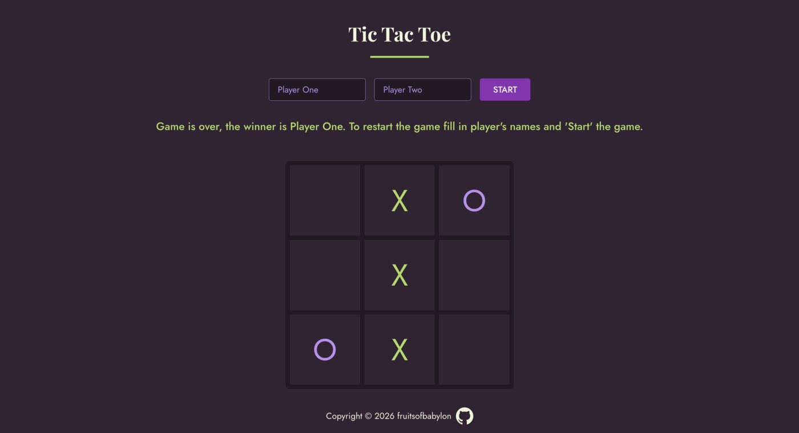

# Tic Tac Toe

A browser-based Tic Tac Toe game for two players, built with vanilla JavaScript, HTML and CSS.

**[Live demo](https://fruitsofbabylon.github.io/odin-tic-tac-toe/)**

## Credits

Project from [The Odin Project](https://www.theodinproject.com/lessons/node-path-javascript-tic-tac-toe)
JavaScript course. CSS reset by [Josh W. Comeau](https://www.joshwcomeau.com/css/custom-css-reset/).
Fonts: Playfair Display and Jost.
